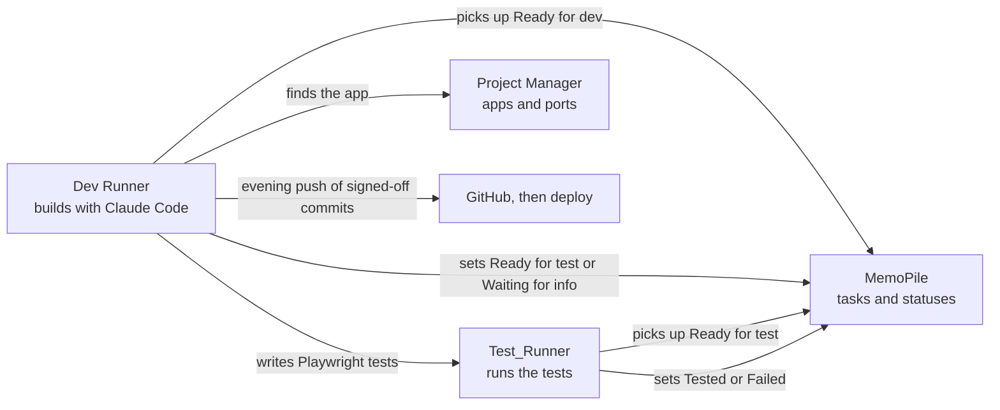
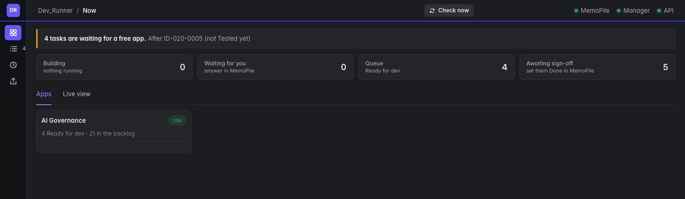
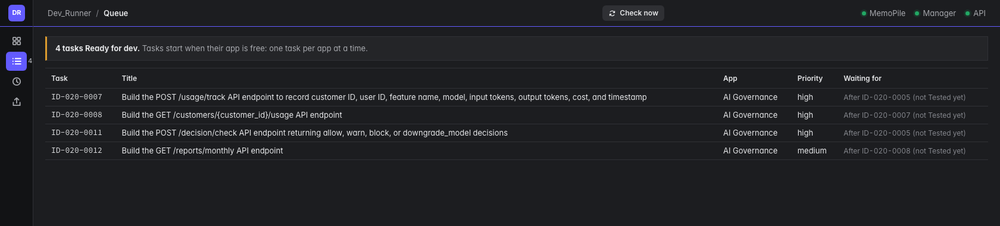
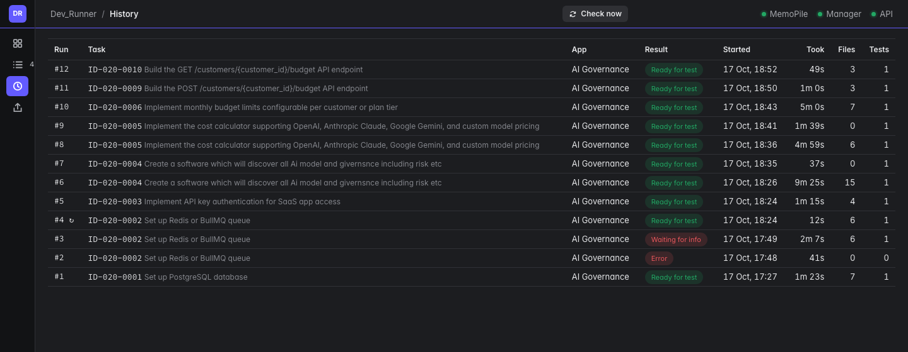
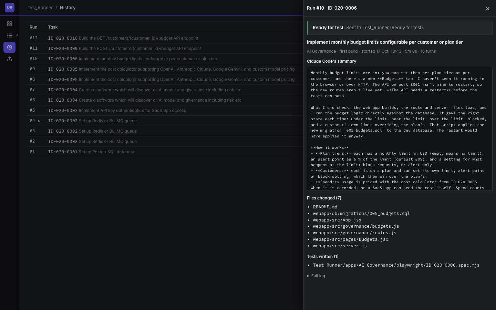
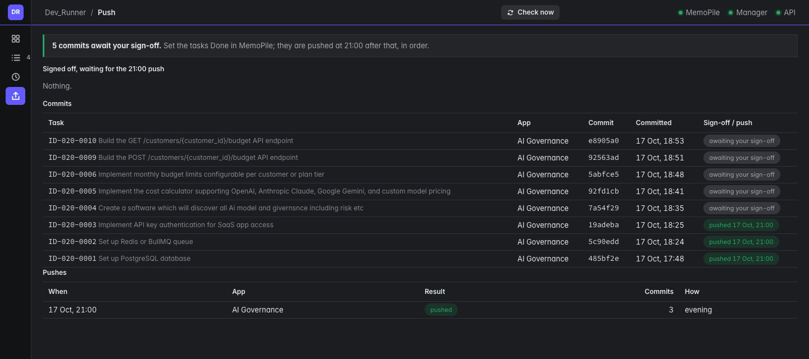

# Dev Runner

> Part of a larger agent platform. ▶ [Watch the 90-second overview](https://github.com/man-pi)

Builds tasks with Claude Code. Set a task to **Ready for dev** in MemoPile and Dev Runner picks it up, builds it in the right app, writes its Playwright tests and hands it over for testing. A person signs off every commit before it ships.

> **Source code is private.** This repository shows what Dev Runner does and how it is built. The code is available on request.

## Why

AI coding agents are fast, but someone still has to feed them work, check what they built and decide what ships. Dev Runner closes that loop: tasks come from MemoPile, Claude Code builds each one with its tests, Test_Runner checks it, and nothing is pushed until a person has signed it off.

## The flow

1. **Ready for dev.** A task is set to Ready for dev in MemoPile. Everything else stays in the backlog.
2. **Pick up.** Dev Runner checks MemoPile's queue every 30 seconds. One task per app at a time; different apps build side by side. A task with a build order waits for the tasks it comes after.
3. **Build.** Claude Code runs in the app with the task, its details, any defect note and the latest comments, following the app's own rules for code, design and stack. It also writes the task's Playwright tests.
4. **Hand over.** The task moves to **Ready for test** and Test_Runner takes it from there. If Claude Code needs something, the task moves to **Waiting for info** with the question, and goes round again once it is answered.
5. **Commit.** The files the task changed are committed locally as soon as it is built, so the app is free for the next task.
6. **Sign off and push.** Tasks are signed off in MemoPile in batches. Every evening Dev Runner pushes each app's signed-off commits in order, stopping at the first one that is not signed off yet.

MemoPile drives both runners by status. Dev Runner never calls Test_Runner, and MemoPile never calls the laptop.

## Screenshots

Real screens; task text and app names are blurred.

| | |
|---|---|
|  |  |
| **Now**: verdict line, counters, a tile per app and the live view of Claude Code's work | **Queue**: tasks ready for dev and what each one is waiting for |
|  |  |
| **History**: every Claude Code run | **Run**: one run's summary, files changed, tests written and full log |
|  | |
| **Push**: commits waiting for sign-off, signed-off commits waiting for the evening push, and every push | |

## Guard rails for the agent

- Claude Code runs headless with a 60 minute limit per run, and any run can be stopped from its panel.
- Pushing, deploying, publishing, rewriting git history and killing processes are blocked for the agent. Committing and pushing are Dev Runner's job; deploying is a person's.
- Secrets, keys, credentials and database files are never committed, whatever a run touched.
- Only files that changed during the run go into its commit, so unrelated work in progress is never swept in.

## How it is built

| Part | Technology |
|---|---|
| Web app | React and Vite UI, Express API |
| Data | SQLite: runs, logs, files changed, tests written and pushes |
| Agent | Claude Code, headless, one run per task, apps built in parallel |
| Version control | One local commit per task, evening push of signed-off commits in order |
| Runs on | A Mac, started by Project Manager |

## Part of a pipeline

- [**MemoPile**](https://github.com/man-pi/memopile-showcase): the AI task pile that feeds the pipeline
- [**Test_Runner**](https://github.com/man-pi/test-runner-showcase): runs Playwright, Cypress, Jest and k6, and reports back
- [**Project Manager**](https://github.com/man-pi/project-manager-showcase): knows every app and starts it
- [**Mission Control**](https://github.com/man-pi/mission-control-showcase): shows all of them side by side

## Licence

Copyright (c) 2026 man-pi. All rights reserved. The screenshots and text in this repository may not be reused without permission.
